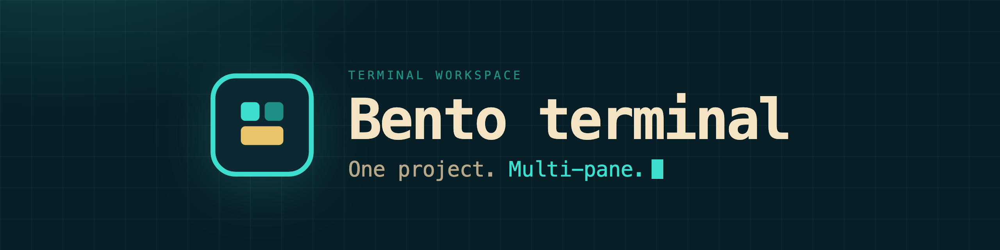

Bento terminal is a full-screen workspace for one project, in the terminal: preview and edit files, read the tree, commits and working-tree changes, run builds, and open a shell — all in one keyboard-first bento layout. It is written in Go with [Bubble Tea](https://github.com/charmbracelet/bubbletea) and targets the macOS Terminal first (Menlo or SF Mono, no Nerd Font).

[](https://github.com/StarkDroid/Bento-Terminal/actions/workflows/ci.yml)
[](https://github.com/StarkDroid/Bento-Terminal/releases/latest)
[](go.mod)
[](LICENSE)
[](https://github.com/StarkDroid/Bento-Terminal)
[](https://goreportcard.com/report/github.com/StarkDroid/Bento-Terminal)
[](https://github.com/StarkDroid/Bento-Terminal/stargazers)
[](https://github.com/StarkDroid/Bento-Terminal/issues)
[](https://github.com/StarkDroid/Bento-Terminal/pulls)

**Site** [starkdroid.github.io/Bento-Terminal](https://starkdroid.github.io/Bento-Terminal/) · **Docs** [install, keys, layout](https://starkdroid.github.io/Bento-Terminal/docs/) · **Releases** [latest](https://github.com/StarkDroid/Bento-Terminal/releases/latest)

## Install

```sh
curl -fsSL https://raw.githubusercontent.com/StarkDroid/Bento-Terminal/main/scripts/install.sh | sh
```

Flags, install directories, and building from a clone are in the [install docs](https://starkdroid.github.io/Bento-Terminal/docs/#install).

## What it does

- **Preview and edit.** Highlighting, folding, and a save in place.
- **Every change.** Modified, staged, untracked, and conflicted paths, with patches.
- **Your shell.** Any command, run inside the project.
- **Builds without setup.** Detected tests, builds, and lint commands.

Editing, changes, the terminal, build detection, shortcuts, mouse, and layout are in the [docs](https://starkdroid.github.io/Bento-Terminal/docs/).

## Develop

```sh
go test ./...
make build
./bento
```

Cross-compile with `make darwin-arm64`, `make darwin-amd64`, `make linux-arm64`, and `make linux-amd64`.

Read [AGENTS.md](AGENTS.md) before changing layout, focus order, theme tokens, or keybindings. The site lives in `website/`; [its README](website/README.md) covers the build. Issues and pull requests are welcome.

## License

MIT. Copyright 2026 Trishiraj. See [LICENSE](LICENSE).
