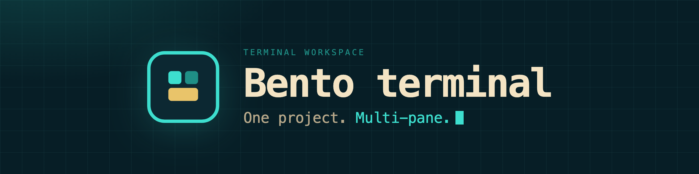

Bento terminal is a full-screen workspace for one project, in the terminal: preview and edit files, read the tree, commits and working-tree changes, run builds, open a shell, and run a coding agent beside the preview — all in one keyboard-first bento layout. It is written in Go with [Bubble Tea](https://github.com/charmbracelet/bubbletea) and runs in the macOS Terminal or Windows Terminal (Menlo, SF Mono, Cascadia Mono; no Nerd Font).

[](https://github.com/StarkDroid/Bento-Terminal/actions/workflows/ci.yml)
[](https://github.com/StarkDroid/Bento-Terminal/releases/latest)
[](https://www.npmjs.com/package/bento-terminal)
[](https://github.com/StarkDroid/homebrew-tap)
[](https://github.com/StarkDroid/scoop-bucket)
[](https://github.com/StarkDroid/Bento-Terminal/releases/latest)
[](go.mod)
[](https://pkg.go.dev/github.com/StarkDroid/Bento-Terminal)
[](LICENSE)
[](https://github.com/StarkDroid/Bento-Terminal)
[](https://goreportcard.com/report/github.com/StarkDroid/Bento-Terminal)
[](https://github.com/StarkDroid/Bento-Terminal/stargazers)
[](https://github.com/StarkDroid/Bento-Terminal/issues)
[](https://github.com/StarkDroid/Bento-Terminal/pulls)

**Site** [starkdroid.github.io/Bento-Terminal](https://starkdroid.github.io/Bento-Terminal/) · **Docs** [install, keys, layout](https://starkdroid.github.io/Bento-Terminal/docs/) · **Releases** [latest](https://github.com/StarkDroid/Bento-Terminal/releases/latest)

## Install

Bento ships as a native binary for macOS, Linux, and Windows. Every route below
installs the same release binary. ❌ means the route is not on the 0.8.1 release
yet.

| Source | Install |
| --- | --- |
| npm / npx | `npx bento-terminal` or `npm install -g bento-terminal` |
| Homebrew | `brew install StarkDroid/tap/bento` |
| Scoop | `scoop bucket add starkdroid https://github.com/StarkDroid/scoop-bucket` then `scoop install bento` |
| ❌ WinGet | `winget install StarkDroid.Bento` |
| ❌ Chocolatey | `choco install bento-terminal` |
| Go | `go install github.com/StarkDroid/Bento-Terminal/cmd/bento@latest` |
| Linux packages | `.deb` or `.rpm` from [releases](https://github.com/StarkDroid/Bento-Terminal/releases/latest) |

WinGet and Chocolatey are not on the 0.8.1 release yet. WinGet has an open
0.7.0 PR, and Chocolatey is in moderation. Until then, use npm, Homebrew,
Scoop, Go, or a release binary.

Then run `bento` inside any project. With no argument it uses the current
directory; `bento <dir>` opens another one.

### Direct download

If you prefer the install scripts:

macOS and Linux:

```sh
curl -fsSL https://raw.githubusercontent.com/StarkDroid/Bento-Terminal/main/scripts/install.sh | sh
```

Windows, in Windows Terminal:

```powershell
irm https://raw.githubusercontent.com/StarkDroid/Bento-Terminal/main/scripts/install.ps1 | iex
```

The Unix installer puts the binary in `~/.local/bin`; `--with-zsh` also adds that folder to PATH. The Windows installer puts `bento.exe` in `%LOCALAPPDATA%\bento` and adds it to your user PATH, so a new Windows Terminal finds `bento`. Flags, install directories, and the source-build path are in the [install docs](https://starkdroid.github.io/Bento-Terminal/docs/#install).

## Updates

Bento checks the public GitHub releases API on startup. If a newer release
exists, it shows an update prompt. Choose **Later** to keep a `u` badge in the
status bar; press `u` to run the update command for your install method
(Homebrew, Scoop, Chocolatey, npm, Go, or the installer). The About overlay
(`,`) shows the current version and the update command. Set
`BENTO_NO_UPDATE_CHECK=1` to skip the check.

## What it does

- **Preview and edit.** Highlighting, folding, and a save in place.
- **Every change.** Modified, staged, untracked, and conflicted paths, with patches.
- **Your shell.** Any command, run inside the project.
- **Builds without setup.** Detected tests, builds, and lint commands.
- **Coding agents.** `ctrl+a` lists Claude Code, OpenCode, Gemini CLI, Codex CLI, Copilot, Crush, Aider, and Cursor; install one or start it beside the preview.

- **Find fast.** `ctrl+p` filters the project's files; `ctrl+f` searches the open file.
- **Pick up where you left off.** Bento remembers recent projects, reopens the file you were reading, and keeps its caret and scroll.

Every build ships the same panes, keys, and behaviour. Only the shell the Terminal panel runs (`$SHELL` on macOS and Linux, `%COMSPEC%` on Windows) and the installer differ per platform.

Search, editing, changes, the terminal, build detection, coding agents, shortcuts, mouse, and layout are in the [docs](https://starkdroid.github.io/Bento-Terminal/docs/).

## Develop

macOS and Linux:

```sh
go test ./...
make build
./bento
sh scripts/install.sh --from-source   # install the checkout, not the release
```

Windows, in Windows Terminal:

```powershell
go test ./...
go build -o bento.exe ./cmd/bento
.\bento.exe
.\scripts\install.ps1 -FromSource     # install the build so `bento` works
```

`go run ./cmd/bento` is the quickest loop on any platform; it runs from a temp directory and touches neither PATH nor the repository. Cross-compile with `make darwin-arm64`, `make darwin-amd64`, `make linux-arm64`, `make linux-amd64`, `make windows-amd64`, and `make windows-arm64`; without `make`, use `go build -o dist\bento_windows_amd64.exe ./cmd/bento`.

The site lives in `website/`; [its README](website/README.md) covers the build. Issues and pull requests are welcome.

Privacy: the app has no telemetry. The website uses privacy-friendly GoatCounter analytics without cookies; see the [privacy page](https://starkdroid.github.io/Bento-Terminal/privacy/).

## License

MIT. Copyright 2026 Trishiraj. See [LICENSE](LICENSE).
